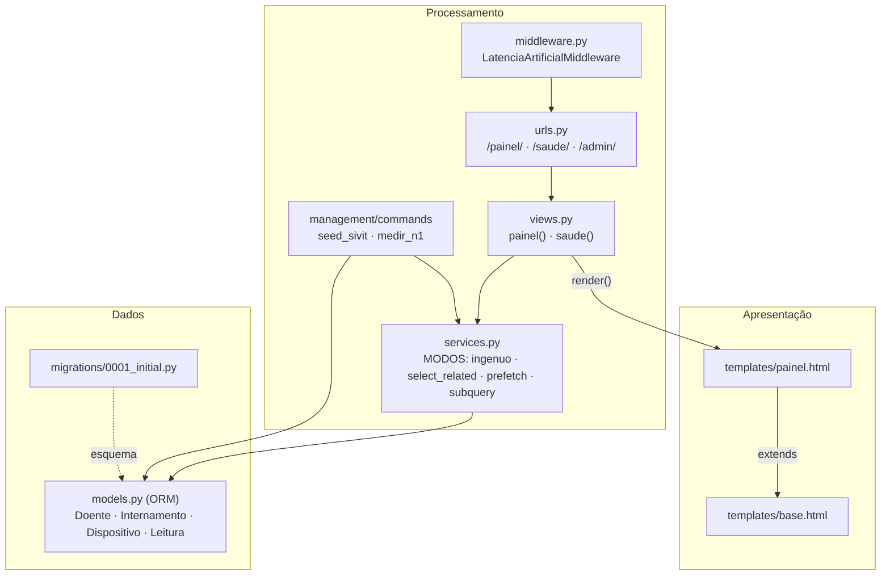
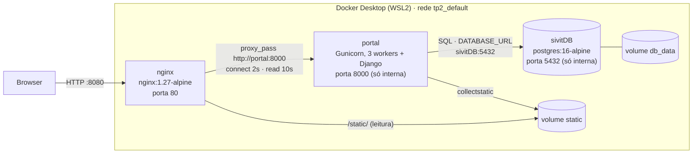

# Arquitetura SIVIT · versão de Beatriz (TP2)

Código em `beatriz/tp2/`. São dois diagramas separados, com perguntas diferentes:
- o de **software** responde a "como está organizado o código?";
- o de **sistema** responde a "onde é que cada coisa corre e como comunica?".

## 1. Diagrama de software (camadas e módulos)

| Camada | Módulos | Responsabilidade |
| --- | --- | --- |
| Apresentação | `templates/` | *como* mostrar: só HTML, sem regras de negócio |
| Processamento | `urls.py`, `views.py` | receber o pedido HTTP, orquestrar e entregar ao template |
| | `services.py` | regras do domínio, **sem HTTP**: a API (TP3) e o consumidor da fila (TP5) vão reutilizá-las |
| | `middleware.py` | código à volta de cada pedido (latência artificial, para as experiências) |
| Dados | `models.py`, `migrations/` | tabelas, relações (`PROTECT`, `SET_NULL`, `CASCADE`) e restrições (`uniq_leitura`) |

Os comandos `seed_sivit` e `medir_n1` usam a mesma camada de serviços que as views: o
`medir_n1` mede exatamente as funções que o painel usa.

## 2. Diagrama de sistema (contentores, rede, volumes)

| Contentor | Imagem | Porta | Papel |
| --- | --- | --- | --- |
| `nginx` | `nginx:1.27-alpine` | **8080** → 80 (a única exposta) | porta de entrada: serve `/static/`, faz de proxy do resto, aplica os timeouts |
| `portal` | `tp2-portal` (build de `portal/`) | 8000, só na rede interna | `arranque.sh`: `migrate`, `collectstatic`, `gunicorn --workers 3` |
| `sivitDB` | `postgres:16-alpine` | 5432, só na rede interna | dados; `healthcheck` com `pg_isready` |

- Os serviços falam **pelo nome** (`portal`, `sivitDB`) através do DNS interno do Docker,
  nunca por IP (B5).
- A configuração vem do ambiente (`.env`, que não está no Git): `DATABASE_URL`,
  `DJANGO_SECRET_KEY`, `DJANGO_DEBUG`, `LATENCIA_MS`.
- O `portal` não guarda estado (os dados estão no `sivitDB` e os estáticos no volume), por
  isso pode ser replicado. O estado vive só no volume `db_data`.
- O `depends_on: service_healthy` garante que o portal só arranca com o PostgreSQL pronto.

## Correspondência entre os dois diagramas

| Camada (software) | Onde corre (sistema) |
| --- | --- |
| Apresentação | contentor `portal` (templates) + `nginx` (estáticos) |
| Processamento | contentor `portal` (Gunicorn + Django) |
| Dados | `models.py` no `portal` + PostgreSQL no contentor `sivitDB` |
