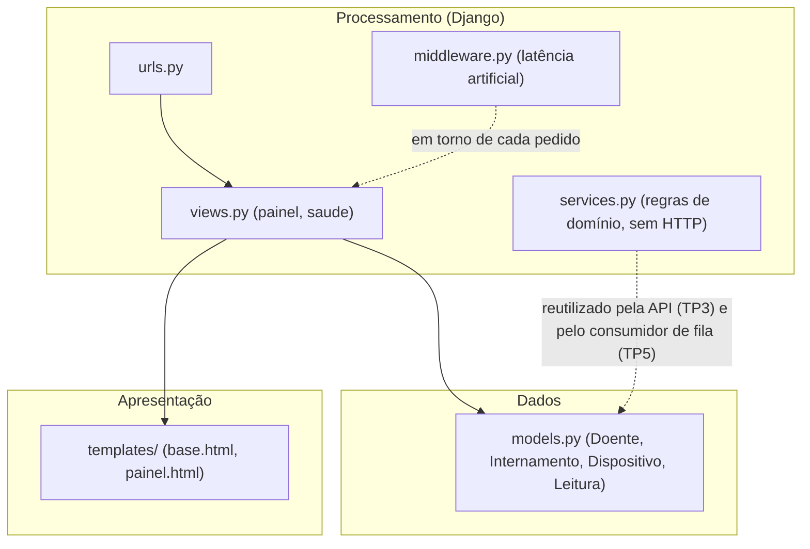
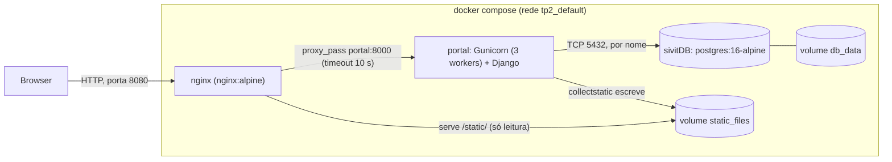

# Arquitetura do portal SIVIT

Dois diagramas, separados de propósito: o primeiro mostra a organização do **código** (módulos e
dependências), o segundo mostra **onde corre** cada coisa (contentores, rede e volumes).

## 1. Diagrama de software

As views falam com os modelos e com os *templates*. O `services.py` contém a lógica de domínio sem HTTP
(por exemplo `registar_leitura`, idempotente graças à restrição `uniq_leitura`), para que a API e o
consumidor de fila a reutilizem sem depender do Django HTTP.

## 2. Diagrama de sistema

Só o Nginx publica uma porta para fora (8080). O portal e a base de dados só são alcançáveis
dentro da rede do Compose, e comunicam por nome (`portal`, `sivitDB`). O volume `db_data` guarda
os dados da BD fora do ciclo de vida do contentor, e o `static_files` é partilhado entre portal
(escreve) e Nginx (lê).
